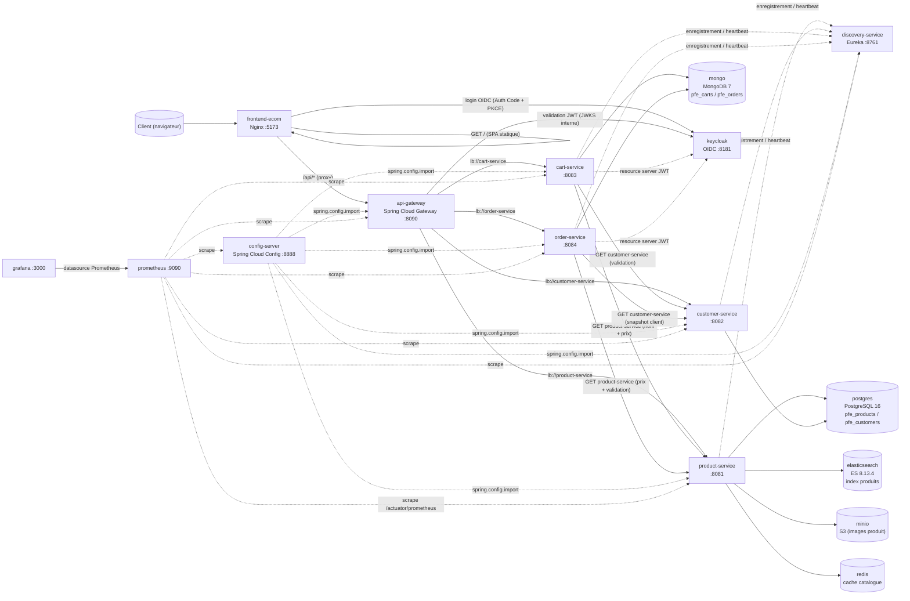

# Guide de soutenance PFE — E-commerce Microservices

**Établissement :** FSAC Casablanca
**Sujet :** Plateforme e-commerce à architecture microservices
**État vérifié :** 13/10/2026 — seuls les éléments marqués « ✅ » ou « vérifié » ont été prouvés par exécution réelle (builds Maven et frontend, **135 tests JUnit**, contrôles HTTP en direct, flux OIDC Keycloak, recherche Elasticsearch, stockage MinIO, cache Redis, cibles Prometheus et tableau de bord Grafana, sur la pile Docker en fonctionnement). Rien n'est inventé ou extrapolé dans ce guide.

> **Mise à jour 13/10/2026** — le projet a évolué depuis la première rédaction : persistance **polyglotte**
> (product/customer sur PostgreSQL, cart/order sur MongoDB), **recherche Elasticsearch** (outbox durable +
> repli PostgreSQL), **stockage d'images MinIO** (S3), **cache Redis** (cache-aside, repli transparent),
> **paiement à la livraison uniquement** (`CASH_ON_DELIVERY`, statut de paiement `PENDING`), **provisionnement
> client idempotent** clé sur le `sub` Keycloak, **Swagger/OpenAPI agrégé**, et un jeu de **manifestes
> Kubernetes** local (validés statiquement, non déployés). Détails : `README.md`, `docs/RUNBOOK_ECOM.md`,
> `docs/ELASTICSEARCH-SETUP.md`, `docs/MINIO-S3-SETUP.md`, `docs/SWAGGER-OPENAPI.md`, `docs/POLYGLOT_PERSISTENCE_DECISION.md`.

Références :
- Documentation opérationnelle : [`docs/RUNBOOK_ECOM.md`](docs/RUNBOOK_ECOM.md)
- Stack de soutenance : [`docker-compose.ecom.yml`](docker-compose.ecom.yml)
- Sources : [`services/`](services/) (backend) et [`frontend-ecom/`](frontend-ecom/) (SPA)

---

## 1. Présentation du projet et problématique

Les plateformes de commerce électronique monolithiques souffrent de limitations structurelles :
couplage fort entre les domaines métier (catalogue, clients, panier, commandes), difficulté de
déploiement indépendant, scaling monolithique, et risque de « faille unique » au niveau applicatif
ou de la base de données. Le passage à l'échelle industrielle suppose de découper le système en
**services métier autonomes**, chacun propriétaire de ses données, orchestrés par un point d'entrée
unique.

Ce projet répond à la problématique suivante :

> Comment concevoir, implémenter et déployer une plateforme e-commerce **microservices**
> complète — catalogue, gestion des clients, panier et commandes — avec configuration centralisée,
> découverte de services, routage via une API Gateway, communication inter-services, **persistance
> polyglotte (PostgreSQL + MongoDB) par service** et interface utilisateur moderne, le tout
> démontrable de bout en bout ?

Le livrable est un système **fonctionnel et vérifié**, déployable en une commande via Docker
Compose, accompagné de tests automatisés et d'une démonstration reproductible.

## 2. Objectifs

### 2.1 Objectifs fonctionnels
- **Catalogue** : lister/créer/modifier/supprimer des produits et catégories ; filtrage du catalogue
  par catégorie dans l'interface.
- **Clients** : créer, consulter, modifier et supprimer des clients ; unicité de l'email ; sélection
  du client courant depuis l'interface.
- **Panier** : un panier par client, ajout de produit avec incrément de quantité, retrait d'une
  ligne, vidage, calcul du total.
- **Commandes** : création d'une commande à partir du panier, avec snapshot du client et des
  produits, total, statut `CONFIRMED` ; liste paginée des commandes ; **paiement à la livraison**
  (méthode `CASH_ON_DELIVERY`, statut de paiement `PENDING` — seule méthode acceptée).
- **Interface** : SPA « ShopPFE » (catalogue avec badges de stock/rupture, panier, historique des
  commandes), en français, responsive, avec états de chargement/vide/erreur et notifications.

### 2.2 Objectifs techniques
- **Microservices** : 4 services métier indépendants (product, customer, cart, order) + découverte
  + gateway + config, packagés en conteneurs.
- **Configuration centralisée** : Spring Cloud Config (config-server, dépôt `config-repo/`), avec
  `fail-fast` et retry au démarrage.
- **Découverte de services** : Eureka (registre) — les adresses ne sont jamais codées en dur.
- **Routage** : Spring Cloud Gateway (WebFlux), routes déclaratives `lb://service-id`, CORS global.
- **Communication inter-services** : `RestClient` équilibré (`@LoadBalanced`) résolu via Eureka.
- **Persistance polyglotte** : `product`/`customer` sur **PostgreSQL** (Spring Data JPA + Flyway,
  intégrité relationnelle : FK, UNIQUE, CHECK) ; `cart`/`order` sur **MongoDB** (agrégats
  documentaires). Volumes Docker persistants ; bases dédiées pour le développement local et les tests.
- **Recherche plein-texte** : **Elasticsearch 8.13.4** (indexation via *outbox* durable PostgreSQL → ES,
  endpoints `/api/products/search` et `/api/products/suggest`) avec **repli PostgreSQL** transparent si
  ES est indisponible.
- **Stockage objet** : **MinIO** (S3) pour les images produit, avec validation (taille/type) et repli
  si indisponible.
- **Cache applicatif** : **Redis** (cache-aside sur le catalogue, invalidation à l'écriture, repli
  transparent à la source PostgreSQL).
- **Provisionnement client** : création **idempotente** de l'utilisateur Keycloak et du client applicatif
  au premier login, clé sur le `sub` OIDC (aucun doublon).
- **Contrat de paiement** : **paiement à la livraison uniquement** (`CASH_ON_DELIVERY`), toute autre
  méthode rejetée (`400`) ; `paymentStatus` initial `PENDING`.
- **Documentation API** : **Swagger/OpenAPI** par service + **agrégation** au gateway.
- **Frontend** : React 19 + Vite 7 + TypeScript strict, servi par Nginx qui proxie `/api` vers le
  gateway.
- **Qualité** : 135 tests verts (intégration MockMvc, sécurité et contraintes base, provenant des rapports Surefire),
  contrôles frontend (`typecheck`, `lint`, `build`) verts, validations HTTP en direct sur la pile tournante.
- **Sécurité** : Keycloak 26.1 (OIDC Authorization Code + PKCE) ; resource servers JWT (gateway,
  cart, order) ; matrice d'autorisation au gateway ; contrôle de **propriété** (403 cross-customer) sur
  cart/order ; identité client issue du jeton (`customer_id`), jamais du navigateur.
- **Observabilité** : chaque service expose `/actuator/prometheus` (Micrometer) ; **Prometheus**
  scrape les 7 cibles ; **Grafana** fournit un tableau de bord provisionné par code (aucune
  configuration manuelle).

## 3. Architecture (diagramme Mermaid)



**Appels inter-services vérifiés (code source + trafic réel) :**
- `cart → product-service` : nom et prix du produit au moment de l'ajout au panier.
- `cart → customer-service` : validation de l'existence du client.
- `order → customer-service` : validation + snapshot nom/email du client.
- `order → product-service` : prix unitaire et validation du produit.

## 4. Responsabilités des services

### product-service (porte 8081 — catalogue)
- Entités `Product` (nom, description, prix, stock, `active`, catégorie) et `Category`.
- `GET /api/products` (paginé Spring Data, `page`/`size` par défaut 0/10), `GET /api/products/{id}`,
  `POST /api/products` (201), `PUT /api/products/{id}`, `DELETE /api/products/{id}` (204).
- `GET /api/categories` (liste plate), `GET /api/categories/{id}`, `POST /api/categories` (201).
- Mapping DTO ↔ entité via **MapStruct** ; gestion d'erreurs centralisée (`GlobalExceptionHandler`).
- Expose Springdoc/OpenAPI, Actuator et métriques Prometheus.

### customer-service (porte 8082 — clients)
- Entité `Customer` (prénom, nom, email, téléphone, dates).
- `GET /api/customers` (paginé `Pageable`), `GET /api/customers/{id}`, `POST /api/customers` (201),
  `PUT /api/customers/{id}`, `DELETE /api/customers/{id}`.
- **Unicité de l'email** : contrôle `existsByEmailIgnoreCase` avant insertion → `409
  DUPLICATE_RESOURCE`.
- Mapping MapStruct, Swagger/OpenAPI, validation Bean Validation sur les DTO d'entrée.

### cart-service (porte 8083 — panier)
- Entités `Cart` (attaché à un `customerId`) et `CartItem` (snapshot `productName`, `unitPrice`,
  `subtotal`).
- `GET /api/carts/{customerId}`, `POST /api/carts/{customerId}/items` (ajout ; **incrément de
  quantité** si le produit est déjà présent), `DELETE /api/carts/{customerId}/items/{itemId}`,
  `DELETE /api/carts/{customerId}` (204, panier vidé).
- **Clients inter-services** : `ProductServiceClient` (nom/prix), `CustomerServiceClient`
  (validation) via `RestClient.Builder` `@LoadBalanced`.
- Total du panier recalculé (somme des sous-totaux, `BigDecimal`).

### order-service (porte 8084 — commandes)
- Entités `Order` (snapshot `customerId`, `customerName`, `customerEmail`, statut, date, `paymentMethod`,
  `paymentStatus`) et `OrderItem` (snapshot produit) ; `OrderStatus` = `CONFIRMED` | `CANCELLED` ;
  `paymentMethod` = `CASH_ON_DELIVERY` (seule valeur acceptée) ; `paymentStatus` initial = `PENDING`.
- `GET /api/orders` (paginé), `GET /api/orders/{id}`, `POST /api/orders` (201) —
  `OrderRequest {customerId, items[{productId, quantity}], paymentMethod}`.
- **Snapshot client et produits** au moment de la commande (ordre et prix figés même si le
  catalogue évolue ensuite) ; statut initial `CONFIRMED`, paiement à la livraison `PENDING`.

## 4bis. Authentification et autorisation (Keycloak OIDC)

Keycloak 26.1 (`start-dev`) expose le realm **`pfeecom`**, importé de façon reproductible depuis
`keycloak/realm-pfeecom.json` (monté en lecture seule). URL publique : `http://localhost:8181`
(conteneur 8080) ; découverte :
`http://localhost:8181/realms/pfeecom/.well-known/openid-configuration`.

- **Clients** : `pfeecom-frontend` (public, **PKCE S256**), `pfeecom-api` (bearer-only, audience).
- **Rôles realm** : `ADMIN`, `CUSTOMER` ; **claim** `customer_id` reliant l'utilisateur au client métier.
- **Utilisateurs de démo** : `admin`/`admin` (ADMIN), `yassine`/`yassine` (CUSTOMER, customer_id 1),
  `sarah`/`sarah` (CUSTOMER, customer_id 2).
- **Frontend** : `keycloak-js` réalise l'Authorization Code + PKCE ; jeton Bearer sur chaque appel ;
  `401` → rafraîchissement → nouvel essai.
- **Backend** : décodeur JWT explicite (JWKS récupéré en interne via `http://keycloak:8080/...`,
  émetteur attendu `http://localhost:8181/realms/pfeecom`), **paresseux** (aucun service ne dépend de
  Keycloak au démarrage).

**Matrice d'autorisation (appliquée par le gateway) :**

| Route | Accès |
|---|---|
| `GET /api/products/**`, `GET /api/categories/**`, `/actuator/health\|info`, `OPTIONS` | **public** |
| `GET /api/customers` (listing) | **ADMIN** |
| `POST/PUT/PATCH/DELETE /api/products\|categories\|customers/**` | **ADMIN** |
| paniers, commandes, `GET /api/customers/{id}` | **authentifié** (+ propriété cart/order) |

Propriété : cart exige `customerId` du chemin == `customer_id` du jeton ; order exige `customerId` du
corps == `customer_id` (création) et cloisonne liste/fiche par client. ADMIN outrepasse. Violation →
**403** ; jeton absent → **401**.

## 5. Découverte, routage, communication inter-services, persistance, livraison frontend

### 5.1 Découverte de services (Eureka)
- `discovery-service` : serveur Eureka (porte 8761), ne s'enregistre pas lui-même
  (`register-with-eureka: false`). Chaque service s'enregistre avec son nom logique
  (`product-service`, `customer-service`, `cart-service`, `order-service`) et un heartbeat.
- Vérifié : le registre `GET /eureka/apps` liste les 5 applications (API-GATEWAY + 4 services)
  UP sur la pile Docker.

### 5.2 API Gateway (Spring Cloud Gateway, WebFlux)
- Port 8080 dans le conteneur, **mappé sur 8090 en hôte** (8080 hôte est occupé par
  `bevaren-keycloak`, infra partagée — ne jamais l'arrêter).
- 4 routes déclaratives explicitement vérifiées dans `/actuator/gateway/routes` :
  `product-service` (`/api/products/**, /api/categories/**`), `customer-service`
  (`/api/customers/**`), `cart-service` (`/api/carts/**`), `order-service` (`/api/orders/**`), toutes
  en `lb://<service-id>`.
- Locator Eureka activé (`discovery.locator.enabled: true`, `lower-case-service-id`), produisant des
  routes automatiques — visibles dans la liste des routes.
- **CORS global** : origines autorisées `http://localhost:5173` et `http://localhost:3000`,
  méthodes GET/POST/PUT/PATCH/DELETE/OPTIONS, `allowCredentials: true`.
- **Resource server OIDC** : le gateway valide le JWT (émetteur + signature via JWKS, expiration) et
  applique la **matrice d'autorisation** (section 4bis) — ✅ vérifié (401 / 403 / public).
- Actuator du gateway sur un **port de gestion interne 8081** (non publié sur l'hôte) : le port public
  8090 n'expose **aucun** endpoint d'actuator (`/actuator/**` → refusé/404). Les routes se consultent
  via le conteneur :
  `docker exec pfe-api-gateway-1 wget -qO- http://127.0.0.1:8081/actuator/gateway/routes`.

### 5.3 Communication inter-services
- Chaque service client (`cart`, `order`) déclare un bean `RestClient.Builder` annoté
  `@LoadBalanced` (`RestClientConfig`) et des clients typés (`ProductServiceClient`,
  `CustomerServiceClient`) qui appellent l'URL logique `http://<service-id>/api/...`.
- Spring Cloud LoadBalancer résout le nom logique via le registre Eureka (un seul point de vérité
  sur les adresses). Les tests isolent ces clients avec `@MockBean`.

### 5.4 Persistance polyglotte (PostgreSQL + MongoDB)
- **Choix par nature de données** : `product-service` et `customer-service` sont **relationnels**
  (intégrité référentielle, unicité, contraintes, transactions ACID) → **PostgreSQL** ;
  `cart-service` et `order-service` sont des **agrégats documentaires** (lignes embarquées, snapshots)
  → **MongoDB**. Justification complète : `docs/POLYGLOT_PERSISTENCE_DECISION.md`.
- **PostgreSQL 16** (`postgres:16-alpine`, conteneur `postgres`, volume `postgres-data`, **aucun port
  hôte**) : deux bases `pfe_products` / `pfe_customers`, deux rôles applicatifs dédiés. Schéma **et**
  données gérés par **Flyway** (`V1__init_schema.sql`, `V2__seed_data.sql`), `ddl-auto=validate` ;
  contraintes `UNIQUE(categories.name)`, `UNIQUE(customers.email_key)`, `CHECK(price > 0)`,
  `CHECK(stock_quantity >= 0)`, FK `products.category_id → categories.id` ; ids via séquences.
- **MongoDB 7** (conteneur `mongo`, volume `mongo-data`) : bases `pfe_carts` / `pfe_orders` **inchangées** ;
  ids via compteur atomique (collection `sequences`) ; entités `@Document`, items embarqués ; audit via
  `@EnableMongoAuditing`. Les anciennes bases Mongo `pfe_products`/`pfe_customers` sont conservées
  **gelées** (rollback).
- Profils : local → PostgreSQL `localhost:5432` (`pfe_*_local`) + MongoDB `localhost:27017` ;
  tests → PostgreSQL `localhost:5433` (conteneur `postgres-test`) + MongoDB `localhost:27018`
  (conteneur `mongo-test`).
- Règle stricte du dépôt : **jamais** `down -v`, `volume prune` ni suppression des volumes
  `postgres-data` / `mongo-data`.

### 5.5 Configuration centralisée (Spring Cloud Config)
- `config-server` (8888, profil `native`) sert `config-repo/` monté en lecture seule ; les 6 clients
  l'importent via `spring.config.import=configserver:http://config-server:8888`.
- `fail-fast: true` + retry : un service refuse de démarrer si le config-server est injoignable
  (prouvé : `ConfigClientFailFastException`). Dépendance de démarrage orchestrée par Docker Compose
  (`depends_on: service_healthy`), sans cycle (le config-server n'utilise ni Eureka ni Mongo).
- Aucun secret en clair : valeurs sensibles par variables d'environnement (`${VAR:defaut}`).

### 5.6 Livraison frontend (Nginx)
- `frontend-ecom` est une **SPA statique** (React 19 + Vite + TypeScript) construite dans une image
  multi-étapes (`node:24-alpine` → `nginx:1.27-alpine`) et servie par Nginx sur le port hôte 5173
  (conteneur 80).
- `nginx.conf` : `location /api/ { proxy_pass http://api-gateway:8080; }` — le client ne connaît que
  l'origine de la SPA ; CORS maîtrisé à la source (une seule origine), pas d'exposition directe des
  microservices au navigateur.
- En développement, Vite proxie `/api` → `http://127.0.0.1:8090` (gateway hôte).

## 6. Technologies et structure du projet

### Technologies (vérifiées dans les `pom.xml` / `package.json`)
| Brique | Technologie |
|---|---|
| Language | Java 21 |
| Framework | Spring Boot **3.3.10** (parent Maven), Spring Cloud **2023.0.5** |
| Découverte | spring-cloud-starter-netflix-eureka-server / eureka-client |
| Gateway | Spring Cloud Gateway (WebFlux, `spring-cloud-starter-gateway`) |
| Configuration | spring-cloud-starter-config (config-server, profil native, `config-repo/`) |
| Persistance | PostgreSQL 16 (`spring-boot-starter-data-jpa` + Flyway, product/customer) ; MongoDB 7 (`spring-boot-starter-data-mongodb`, cart/order) |
| Recherche | Elasticsearch 8.13.4 (`spring-boot-starter-data-elasticsearch` 5.3.x), outbox durable + repli PostgreSQL |
| Stockage objet | MinIO (S3, `software.amazon.awssdk:s3`), images produit |
| Cache | Redis 7.4 (`spring-boot-starter-data-redis`, cache-aside, repli transparent) |
| Inter-services | `RestClient` + `@LoadBalanced` (spring-cloud-loadbalancer, transitif via eureka) |
| Mapping DTO | MapStruct (product, customer) ; mapping manuel (cart, order) |
| Documentation | springdoc-openapi (Swagger UI `/swagger-ui.html`) sur les 4 services |
| Sécurité | Keycloak 26.1 (OIDC), `spring-boot-starter-oauth2-resource-server` (gateway, cart, order), `keycloak-js` (frontend) |
| Observabilité | Actuator + `micrometer-registry-prometheus` (`/actuator/prometheus`), Prometheus 2.54, Grafana 11.2 |
| Tests | Spring Boot Test, MockMvc, PostgreSQL (`postgres-test`) + MongoDB (`mongo-test`) + Redis (`redis-test`) + Elasticsearch (`localhost:9200`) |
| Frontend | React 19.1, Vite 7.1, TypeScript 5.9 (strict), ESLint 9 (flat config) |
| Conteneurs | Docker, Docker Compose (PostgreSQL 16, MongoDB 7, Redis 7.4, Elasticsearch 8.13.4, MinIO, Keycloak 26.1, Nginx, eclipse-temurin JRE 21) |

### Structure
```
docker-compose.ecom.yml        # 16 conteneurs : config-server + discovery + postgres + mongo + elasticsearch + minio + redis + keycloak + 4 services + gateway + frontend + prometheus + grafana
config-repo/                   # configuration centralisée (lue par config-server)
services/
  config-server/               # Spring Cloud Config (8888, profil native)
  discovery-service/           # serveur Eureka (8761)
  api-gateway/                 # Spring Cloud Gateway (8090 hôte), resource server JWT
  product-service/             # catalogue : /api/products, /api/categories (8081)
  customer-service/            # clients : /api/customers (8082)
  cart-service/                # paniers : /api/carts (8083), resource server JWT
  order-service/               # commandes : /api/orders (8084), resource server JWT
frontend-ecom/                 # SPA ShopPFE (src/, Dockerfile multi-étapes, nginx.conf), keycloak-js
keycloak/                      # realm pfeecom (import OIDC reproductible)
monitoring/                    # prometheus.yml + provisioning Grafana + dashboards JSON
docs/RUNBOOK_ECOM.md           # runbook opérationnel complet
GUIDE_SOUTENANCE.md            # présent guide
```

Chaque service est organisé en couches : `controller` → `service` (+ `impl`) → `repository`,
`domain/entity`, `dto/{request,response}`, `mapper`, `client` (inter-services), `exception`
(GlobalExceptionHandler).

## 7. Propriété des données et relations

- **Productivité par service (pattern « data ownership »)** : chaque microservice possède **sa**
  base de données et aucune table n'est partagée entre services. Aucun service ne lit la base d'un
  autre : les données nécessaires transitent par les API (**appels inter-services**) ou par des
  **snapshots**.
- `customer-service` est la source de vérité du client (email unique, validation). `cart-service`
  stocke un `customerId` (référant logique, sans FK vers une autre base) et des lignes de panier
  autonomes.
- `order-service` **fige** (`snapshot`) le client (`customerName`, `customerEmail`) et chaque produit
  (`productName`, `unitPrice`, `subtotal`) : une commande reste stable même si le catalogue ou le
  client changent ensuite.
- `product-service` est la source de vérité du catalogue (prix, stock, activité) ; cart et order en
  dérivent nom/prix **au moment de l'opération**.
- Conséquence assumée : pas de transaction distribuée entre services (cohérence finale et
  snapshots) — voir limites (section 12).

## 8. Démonstration en direct 10–15 minutes (workflow vérifié)

Prérequis : pile Docker démarrée, 16/16 conteneurs healthy (section 9).

1. **[1 min] Contexte** — énoncer la problématique (section 1) et montrer le diagramme
   d'architecture (section 3).
2. **[2 min] Registre Eureka** — `http://127.0.0.1:8761` : 5 applications UP. Ouvrir
   `/actuator/gateway/routes` (via le conteneur, section 5.2) : les 4 routes `lb://` explicites.
3. **[1 min] Santé** — actuator du gateway sur le port de gestion **interne** :
   `docker exec pfe-api-gateway-1 wget -qO- http://127.0.0.1:8081/actuator/health` (composite UP).
   Le port public 8090 n'expose pas l'actuator.
4. **[1 min] Authentification** — ouvrir Keycloak `http://127.0.0.1:8181` (realm `pfeecom`, rôles
   `ADMIN`/`CUSTOMER`, utilisateurs de démo) ; illustrer un jeton via le grant « password »
   (usage test, section 4bis).
5. **[5 min] Parcours complet dans la SPA** — ouvrir `http://127.0.0.1:5173` (**login Keycloak requis**) :
   a. Se connecter en `yassine`/`yassine` (CUSTOMER) : le sélecteur de client est absent ; le panier
      est le sien.
   b. Catalogue : produits et filtres de catégorie (lecture **publique**).
   c. Ajouter un produit au panier : badge incrémenté ; le panier affiche nom + prix —
      **issus de l'appel `cart → product-service`**.
   d. Augmenter la quantité (+) : vérifie l'**incrément de quantité** côté `cart-service`.
   e. « Passer commande » : commande `CONFIRMED` + total, **paiement à la livraison** (`CASH_ON_DELIVERY`,
      `paymentStatus=PENDING`) — appels `order → customer` et `order → product`.
   f. Onglet « Commandes » : historique **cloisonné** au client connecté.
6. **[2 min] Sécurité via le gateway** — `GET /api/customers` sans jeton → **401** ; avec jeton
   `yassine` → **403** ; avec jeton `admin` → **200**. `GET /api/carts/2` avec jeton `yassine` →
   **403** (cross-customer).
7. **[1 min] Erreurs contrôlées** — montrer les réponses structurées via l'API :
   - client/produit inconnu → **404** `NOT_FOUND` ;
   - email dupliqué → **409** `DUPLICATE_RESOURCE` ;
   - JSON malformé → **400** `MALFORMED_JSON` ;
   - validation (nom vide, quantité 0) → **400** `VALIDATION_FAILED`.
8. **[1 min] Observabilité** — Prometheus `http://127.0.0.1:9090/targets` (**7 UP**) ; Grafana
   `http://127.0.0.1:3000` → dashboard « PFE E-commerce - Vue d'ensemble » ; générer du trafic et
   montrer l'évolution du débit HTTP / latence p95.
8bis. **[1 min, optionnel] Recherche, images, OpenAPI** — recherche **Elasticsearch** dans la SPA
   (`/search?q=bluetooth`, surlignage ; suggestions au fil de la frappe) ; **image produit MinIO**
   (téléversement ADMIN puis affichage public) ; **Swagger agrégée** `http://localhost:8090/swagger-ui.html`.
9. **[1 min] Persistance** — `down` puis `up -d` : les données (produits/clients sur PostgreSQL,
   paniers/commandes sur MongoDB) sont toujours là (volumes `postgres-data` + `mongo-data`), ainsi que
   les dashboards (volume `grafana-data`).
10. **[1 min] Qualité** — mentionner les 135 tests verts (section 10) et les contrôles frontend.

> Données de démonstration (seed idempotent) : 2 catégories (Accessories, Audio), 3 produits
> (Docker Product 49,99 €, Charger 19,99 €, Casque Bluetooth 89,90 €), 2 clients (Yassine Alami,
> Sarah Berrada). Les exemples rejoués pendant la démo créent des données supplémentaires — c'est
> l'effet attendu.

## 9. Commandes de démarrage et URLs (extraits du runbook)

### Démarrage Docker (persistance polyglotte PostgreSQL + MongoDB) — **mode de démonstration**
```powershell
docker compose -f docker-compose.ecom.yml up -d --build
docker compose -f docker-compose.ecom.yml ps        # 16 containers healthy + minio-init (Exited 0)
```

### Arrêt (préserve les données)
```powershell
docker compose -f docker-compose.ecom.yml down        # JAMAIS down -v
```

### Démarrage local (JARs, PostgreSQL + MongoDB locaux, sans Docker)
```powershell
cd services/config-server     ; mvn -B clean package
cd services/discovery-service ; mvn -B clean package
cd services/product-service   ; mvn -B clean package
cd services/customer-service  ; mvn -B clean package
cd services/cart-service      ; mvn -B clean package
cd services/order-service     ; mvn -B clean package
cd services/api-gateway       ; mvn -B clean package

# Variables : CONFIG_SERVER_IMPORT=configserver:http://localhost:8888 ; SPRING_PROFILES_ACTIVE=local
# Ordre : config-server -> discovery -> services -> gateway
java -jar services/config-server/target/config-server-0.0.1-SNAPSHOT.jar
java -jar services/discovery-service/target/discovery-service-0.0.1-SNAPSHOT.jar
java -jar services/product-service/target/product-service-0.0.1-SNAPSHOT.jar --spring.profiles.active=local
java -jar services/customer-service/target/customer-service-0.0.1-SNAPSHOT.jar --spring.profiles.active=local
java -jar services/cart-service/target/cart-service-0.0.1-SNAPSHOT.jar --spring.profiles.active=local
java -jar services/order-service/target/order-service-0.0.1-SNAPSHOT.jar --spring.profiles.active=local
java -jar services/api-gateway/target/api-gateway-0.0.1-SNAPSHOT.jar --spring.profiles.active=local
```

### URLs
| Ressource | URL |
|---|---|
| Frontend (SPA, démo) | http://127.0.0.1:5173 |
| API Gateway | http://127.0.0.1:8090 |
| Config Server | http://127.0.0.1:8888 |
| Eureka (registre) | http://127.0.0.1:8761 |
| Keycloak (OIDC) | http://127.0.0.1:8181 (realm `pfeecom`) |
| Prometheus | http://127.0.0.1:9090 |
| Grafana | http://127.0.0.1:3000 |
| Santé gateway | `docker exec pfe-api-gateway-1 wget -qO- http://127.0.0.1:8081/actuator/health` (port de gestion interne, non publié) |
| Routes gateway | `docker exec pfe-api-gateway-1 wget -qO- http://127.0.0.1:8081/actuator/gateway/routes` |
| Registre (JSON) | `Invoke-RestMethod -Headers @{Accept="application/json"} http://127.0.0.1:8761/eureka/apps` |
| OpenAPI par service (local) | http://127.0.0.1:808X/swagger-ui.html (X = 1..4) |
| Metrics | `/actuator/prometheus` (interne) sur les 7 services — visualisation via Prometheus/Grafana |

> Le dev server Vite écoute `localhost` (possiblement IPv6 `::1`) : en développement, y accéder via
> `http://localhost:5173` et non `127.0.0.1:5173`. En Docker, Nginx écoute sur les deux. Le port
> hôte 8080 est réservé à `bevaren-keycloak` (ne pas y toucher).

## 10. Builds, contrôles frontend et tests — vérifiés

### 10.1 Tests automatisés backend (JUnit 5 + MockMvc, PostgreSQL + MongoDB de test)
Résultats exacts des rapports **Surefire** (`target/surefire-reports/*.txt`) :

| Service | Classe(s) de test (nb) | Tests | Résultat |
|---|---|---|---|
| product-service | `ProductApiIntegrationTest` (22), `ProductImageIntegrationTest` (8), `ProductSearchElasticsearchTest` (6), `ProductCacheRedisTest` (5), `ProductCacheOutageTest` (2), `MinioStorageServiceTest` (8), `ProductOpenApiTest` (1) | **52** | 52/52, 0 échec |
| customer-service | `CustomerApiIntegrationTest` (9), `ProvisioningServiceImplTest` (7), `CustomerOpenApiTest` (1) | **17** | 17/17, 0 échec |
| cart-service | `CartApiIntegrationTest` (12), `CartSecurityTest` (6), `CartOpenApiTest` (1) | **19** | 19/19, 0 échec |
| order-service | `OrderApiIntegrationTest` (11), `OrderSecurityTest` (5), `OrderOpenApiTest` (1) | **17** | 17/17, 0 échec |
| api-gateway | `GatewaySecurityTest` (19), `CustomerProfileOwnershipTest` (6), `GatewayDocsSecurityTest` (5) | **30** | 30/30, 0 échec |
| config-server / discovery-service | (aucun test automatisé) | 0 | build OK |
| **Total** | | **135** | **135/135, Failures: 0, Errors: 0, Skipped: 0** |

- Ces tests exécutent le contexte Spring complet (WebApplicationContext, MockMvc) ; les clients
  inter-services (`ProductServiceClient`, `CustomerServiceClient`) sont mockés (`@MockBean`) ; Eureka
  et le Config client sont désactivés et des dépendances de test sont configurées (PostgreSQL
  `postgres-test:5433`, MongoDB `mongo-test:27018`, Redis `redis-test:6380`, Elasticsearch
  `localhost:9200`, MinIO). Ce sont donc des **tests d'intégration backend** automatisés, distincts
  des contrôles HTTP manuels ci-dessous.
- Les tests **Elasticsearch** de product-service (`ProductSearchElasticsearchTest`, 6) nécessitent un ES
  joignable sur `localhost:9200` ; le délai de connexion/socket de test a été porté à 5 s / 30 s pour
  absorber une brève pause GC du conteneur ES mono-nœud (heap 512 Mo) — correctif de test uniquement,
  aucun impact sur la logique applicative.
- Les tests de **sécurité** (cart 6, order 5, gateway 19 + profil client 6 = 36) vérifient la matrice
  d'autorisation et la propriété : jeton absent → 401, rôle insuffisant / cross-customer → 403, accès
  admin. Ils utilisent un décodeur JWT factice (aucun appel réseau à Keycloak).
- Commande : `mvn test` dans chaque `services/*-service` (prérequis : conteneurs `postgres-test`,
  `mongo-test`, `redis-test` démarrés et Elasticsearch joignable sur `localhost:9200`).

### 10.2 Contrôles frontend (automatisés, statiques)
Vérifiés dans `frontend-ecom/` (exit code 0) :
- `npm run typecheck` — `tsc --noEmit` (TypeScript strict) : **OK**.
- `npm run lint` — ESLint 9 (flat config, plugins react-hooks/react-refresh) : **0 erreur**, 5
  avertissements de style (`react-refresh/only-export-components`).
- `npm run test` — `node --test test/format.test.ts` : **3/3**.
- `npm run build` — `tsc --noEmit && vite build` : **OK** ; artefacts produits : `assets/index-*.js`
  (~421 ko) et `assets/index-*.css` (~26 ko).

### 10.3 Contrôles HTTP en direct (manuels, sur la pile tournante)
Le jour de la validation, la pile Docker en cours d'exécution a été **explicitement testée via
HTTP** (Invoke-RestMethod / curl.exe depuis l'hôte) :
- `GET http://127.0.0.1:5173/` → 200 (SPA servie par Nginx) ;
- `GET /api/categories` → 200 (2 catégories), `GET /api/products?page=0&size=100` → 200 paginé ;
- `POST /api/customers` → 201 (puis 409 sur email dupliqué) ;
- `POST /api/carts/{id}/items` → 200 avec `productName`/`unitPrice` issus de `product-service`
  (snapshot vérifié) ; `GET /api/carts/{id}` → 200 avec total ;
- `POST /api/orders` → 201, statut `CONFIRMED`, total exact, `paymentMethod=CASH_ON_DELIVERY`,
  `paymentStatus=PENDING`, `customerName` issu de `customer-service` ; méthode de paiement non
  supportée → **400** ;
- chemins d'erreur → 404 `NOT_FOUND`, 400 `VALIDATION_FAILED`, 400 `MALFORMED_JSON` ;
- actuator du gateway (via le conteneur, port de gestion 8081) : routes `lb://` + locator,
  `health` UP ; `/eureka/apps` (5 applications UP) ;
- sécurité via le gateway : `GET /api/customers` sans jeton → 401, jeton `yassine` → 403, jeton
  `admin` → 200 ; `GET /api/carts/2` avec jeton `yassine` → 403 (cross-customer) ;
- observabilité : Prometheus `/api/v1/targets` → **7 cibles UP** ; datasource Grafana OK et dashboard
  provisionné (11 panneaux, requêtes renvoyant des séries réelles).

**Distinction à énoncer au jury** : les tests automatisés (10.1/10.2) prouvent le comportement dans
un environnement isolé et reproductible ; les contrôles HTTP en direct (10.3) prouvent
l'intégration réelle de la pile déployée (Config Server + Eureka + gateway + inter-services + PostgreSQL + MongoDB + Nginx).

### 10.4 Smoke test E2E navigateur (non destructif) — exécuté le 13/10/2026

Exécuté avec **Chrome headless piloté par le CDP** (Chrome DevTools Protocol) via un petit script
Node **sans aucune dépendance ajoutée** (WebSocket natif de Node 24). **Aucune écriture** : uniquement
des `GET` et de la navigation.

| Contrôle | Résultat |
|---|---|
| Rendu SPA `http://localhost:5173/` | `ShopPFE — Boutique microservices`, React monté, catalogue (Accessories, Audio), contrôles `Connexion`/`Inscription`, **0 erreur console** |
| Proxy Nginx `/api` | `GET /api/products` → **200** (JSON), `GET /api/categories` → **200** |
| Recherche Elasticsearch | `GET /api/products/search?q=bluetooth` → **200**, `degraded=false`, 1 résultat |
| Frontière d'authentification | `GET /api/customers` sans jeton → **401** ; `GET /api/orders` sans jeton → **401** |
| Redirection OIDC | clic sur `Connexion` → redirection vers `…/realms/pfeecom/protocol/openid-connect/auth` (**PKCE S256**, `state` + `nonce`) ; page `Se connecter à PFE E-commerce` (champs utilisateur/mot de passe) |

> **Périmètre honnête** : ce smoke prouve le **rendu**, le **proxy**, la **recherche** et les
> **frontières d'authentification** ; il ne soumet **aucun identifiant**. Le parcours **authentifié
> panier → commande** dans le navigateur n'est **pas** rejoué automatiquement (il écrirait des
> données métier) — il est couvert manuellement via l'API (§10.3) et reste à montrer en démo.

## 11. Checklist des captures d'écran (à prendre depuis l'application réelle)

Enregistrer dans `docs/assets/`. Ouvrir la SPA `http://127.0.0.1:5173`.

> NB : les images actuellement présentes dans `docs/assets/` sont anciennes et ne correspondent pas à
> la stack e-commerce actuelle — **à remplacer** par des captures prises sur la pile réelle
> (SPA « ShopPFE », Prometheus, Grafana). Voir `docs/assets/README.md`.
>
> Les slides (`soutenance/soutenance.pptx`, généré par `soutenance/make_slides.py`) attendent des
> fichiers nommés `ecom-app.png`, `ecom-grafana.png`, `ecom-prometheus.png`, `ecom-keycloak.png` ;
> un cadre « capture à insérer » s'affiche tant qu'ils sont absents.

1. **Eureka** — dashboard : 5 applications UP (capture du registre).
2. **Gateway routes** — `docker exec pfe-api-gateway-1 wget -qO- http://127.0.0.1:8081/actuator/gateway/routes` (JSON) : 4 routes `lb://` + locator.
3. **Santé gateway** — `docker exec pfe-api-gateway-1 wget -qO- http://127.0.0.1:8081/actuator/health` : composite UP.
4. **Keycloak** — écran de login du realm `pfeecom` (ou console d'admin : rôles `ADMIN`/`CUSTOMER`, users).
5. **SPA — Catalogue** : produits avec prix, stock, rupture et badge catégorie (données réelles).
6. **SPA — Panier** : lignes (nom × quantité, sous-totaux) et total formaté € (fr-FR) ; badge du
   compteur.
7. **SPA — Commande confirmée** : notification « Commande #N confirmée — montant ».
8. **SPA — Onglet Commandes** : cartes de commande `CONFIRMED` (badge paiement à la livraison) avec
   client snapshot et total.
9. **Erreurs contrôlées** — captures API (PowerShell) : 404 `NOT_FOUND`, 409
   `DUPLICATE_RESOURCE`, 400 `VALIDATION_FAILED`, 401/403 (sécurité).
10. **Prometheus** — `http://127.0.0.1:9090/targets` : 7 cibles UP ; `/graph` avec une requête PromQL.
11. **Grafana** — dashboard « PFE E-commerce - Vue d'ensemble » (11 panneaux avec données).
12. **Tests** — rapport de `mvn test` (135 tests verts) ou terminal du run final.
13. **Persistance** — après `down`/`up`, le panier ou la commande précédemment créés sont encore
    présents.
14. **Docker** — `docker compose ps` : 16/16 healthy (+ `mongo-test`/`postgres-test`/`redis-test` si profil de test actif).

## 12. Limites et perspectives

Limites **réelles** (non masquées, à assumer avec des pistes d'amélioration) :
- **Appels inter-services sans jeton** : product/customer restent ouverts en interne ; cart/order les
  appellent sans propager de jeton (pas de mTLS ni de token relay). L'isolation repose sur la frontière
  réseau Docker (aucun service métier publié sur l'hôte). *Perspective : client-credentials ou mTLS.*
- **Sécurité et observabilité de démonstration** : realm Keycloak importé avec des utilisateurs de
  démo et `direct access grant` activé (tests) ; Prometheus non authentifié et sans règles d'alerting
  (seuls des dashboards Grafana sont fournis) ; Grafana avec identifiants par défaut surchargeables par
  variables d'environnement. *Perspective : secrets/TLS réels, désactivation du grant password,
  Alertmanager.*
- **Absence de transaction distribuée** : `order` et `cart` utilisent des snapshots et des appels
  synchrones, sans saga ni événementiel. En cas de panne d'un service en aval, l'opération échoue
  proprement (404/500) sans corruption de données, mais sans compensation automatique.
- **Stock non décrémenté** : `cart`/`order` lisent le stock mais ne le décrémentent pas
  (perspective : réservation/saga, ou décrément dans `createOrder` avec contrôle d'échec).
- **Pas de versioning d'API explicite** (chemins en `/api/v1/…` non implémentés), pas de
  cache/distribution horizontale multi-instances démontrée pour chaque service.
- **Tests** : MockMvc (contexte + mocks des clients inter-services), pas de tests de contrat (WireMock).
  Pas de **suite E2E** frontend (pas de Vitest/Playwright — volontaire) ; un **smoke test navigateur
  non destructif** (Chrome headless + CDP, zéro dépendance) a toutefois été exécuté (rendu SPA, proxy,
  recherche, frontières 401, redirection OIDC — cf. §10.4). Le parcours authentifié panier → commande
  reste validé manuellement (API, §10.3).

Déjà traité dans la vérification : authentification OIDC (Keycloak) et autorisation par
rôle/propriété, observabilité déployée (Prometheus 7/7 cibles + dashboard Grafana), redémarrage avec
persistance des volumes, erreurs contrôlées, CORS, dossier `docs/` et runbook à jour.

## 13. Questions probables du jury et réponses suggérées

1. **Pourquoi une architecture microservices et pas un monolithe ?**
   Découplage des domaines (catalogue/clients/panier/commandes), déploiement et scaling
   indépendants, isolation des données ; chaque service peut être réécrit/scalé séparément. Le
   monolithe souffre du couplage et d'un point de défaillance unique. En contrepartie, nous gérons
   la complexité distribuée : découverte, routage, cohérence (snapshots, section 7).

2. **Pourquoi une base par microservice ?**
   « Data ownership » : seul le service écrit dans sa base, aucune table partagée, évolution
   autonome des schémas (DDL distinct par service). C'est un pattern standard des microservices.
   Inconvénient assumé : pas de jointure inter-bases → données rapprochées par API ou snapshots.

3. **Comment un service connaît-il l'adresse d'un autre ?**
   Il appelle l'URL logique `http://product-service/...`. Spring Cloud LoadBalancer (`@LoadBalanced`
   sur `RestClient.Builder`) résout ce nom auprès du registre Eureka (healthchecks, instancie
   multiple possible) et fournit l'adresse réellement joignable. Aucun `localhost:port` codé en dur.

4. **Comment le gateway sait-il où router ?**
   Routes déclaratives `lb://<service-id>` + predicats de chemin (`/api/customers/**` →),
   complétées par le discovery locator d'Eureka. Vérifié via `/actuator/gateway/routes`.

5. **Pourquoi le panier stocke-t-il nom et prix du produit ?**
   C'est un **snapshot** (« prix d'ajout ») : l'historique du panier d'un client reste fidèle même
   si le catalogue change. Idem pour la commande (prix définitif au moment de la commande,
   invariable ensuite). Le prix courant reste consulté à chaque ajout via `product-service`.

6. **Que se passe-t-il si product-service est indisponible lors d'un ajout au panier ?**
   L'appel inter-service échoue ; `cart-service` le propage (erreur gérée, aucun produit « bricolé »
   n'est inséré) et la transaction n'est pas validée. La réponse est une erreur propre (404/500
   structurée par le `GlobalExceptionHandler`), pas de donnée incohérente.

7. **Comment garantissez-vous l'unicité de l'email ?**
   Contrôle applicatif `existsByEmailIgnoreCase` avant insertion dans `CustomerServiceImpl`, suivi
   de la contrainte de schéma ; l'exception `DuplicateResourceException` est mappée en **409
   `DUPLICATE_RESOURCE`** par le `GlobalExceptionHandler`. Un test MockMvc le vérifie.

8. **Erreurs HTTP : comment sont-elles standardisées ?**
   `GlobalExceptionHandler` (`@RestControllerAdvice`) retourne un corps uniforme
   `{timestamp, status, code, message, details}` : `NOT_FOUND` (404), `VALIDATION_FAILED` (400),
   `MALFORMED_JSON` (400), `DUPLICATE_RESOURCE` (409), `INTERNAL_ERROR` (500).

9. **Pourquoi Nginx devant la SPA ?**
   Le frontend est un build statique (image node) servi par Nginx ; `location /api/` proxie vers le
   gateway. Le navigateur ne voit qu'une seule origine (pas de CORS, pas d'exposition directe des
   microservices), et Nginx est un serveur léger et robuste pour le statique.

10. **Quelle différence entre les 135 tests et vos contrôles « en direct » ?**
    Les tests (JUnit + MockMvc, bases PostgreSQL/MongoDB de test, clients inter-services mockés,
    Config/Eureka désactivés) sont reproductibles et isolés : ils prouvent le comportement de chaque
    service. Les contrôles HTTP en direct sur la pile Docker complète prouvent l'intégration réelle
    (Config Server + Eureka + gateway + inter-services + PostgreSQL + MongoDB + Nginx). Les deux sont
    complémentaires (voir section 10).

11. **Comment gérez-vous la cohérence entre services sans transaction distribuée ?**
    Par **snapshots** et validation amont : `order` valide le client et les produits via les API
    avant création, puis fige les données utiles. Nous assumons une cohérence éventuelle plutôt
    qu'atomique ; les transactions localisées restent ACID (base propre). Limite reconnue (section
    12) pour un futur event-driven/saga.

12. **Le frontend est-il « connecté » ou « mocké » ?**
    Connecté. Toutes les données affichées (catalogue, clients, panier, commandes) proviennent de
    la pile réelle via `/api` (proxy Nginx en prod, proxy Vite en dev) ; aucune donnée simulée dans
    l'interface. La vérification E2E le prouve (section 10.3).

13. **Et la sécurité ?**
    L'authentification est intégrée via Keycloak (OIDC, Authorization Code + PKCE) : le gateway est
    resource server et applique la matrice d'autorisation (public : catalogue en lecture ; ADMIN :
    écritures et listing clients ; authentifié : paniers/commandes/profil). cart et order ajoutent le
    contrôle de propriété (`customer_id` du jeton → 403 cross-customer). Limites assumées : appels
    inter-services sans jeton, utilisateurs de démo, pas de mTLS (section 12).

14. **Pourquoi deux SGBD (persistance polyglotte) plutôt qu'un seul ?**
    Parce que les deux familles de données ont des besoins opposés. `product`/`customer` sont des
    **référentiels relationnels** : unicité (email, nom de catégorie), intégrité référentielle
    (produit → catégorie), contraintes (`prix > 0`, `stock ≥ 0`) et transactions ACID → **PostgreSQL**.
    `cart`/`order` sont des **agrégats documentaires** lus/écrits en bloc (panier + lignes, commande +
    snapshots) → **MongoDB**. On migre ainsi **le minimum** (2 services sur 4), sans toucher aux
    contrats d'API ni à la sécurité, et les données MongoDB existantes sont **préservées**. Détail et
    alternatives écartées : `docs/POLYGLOT_PERSISTENCE_DECISION.md`.

15. **Comment gérez-vous le schéma et les données PostgreSQL ?**
    Par **Flyway** (`V1__init_schema.sql` pour le schéma, `V2__seed_data.sql` pour les données de
    démo), avec `ddl-auto=validate` : Hibernate ne modifie jamais le schéma, il le vérifie au
    démarrage. Les identifiants proviennent de séquences PostgreSQL ; l'unicité et les contraintes
    sont garanties **au niveau base** (et non seulement applicatif), ce que prouvent 3 tests dédiés
    (email dupliqué, FK catégorie, CHECK prix/stock).

## 14. Checklist de répétition « from scratch »

Répéter la démo au complet au moins 2 fois **à blanc** (machine redémarrée, sans processus Docker
préexistants), chronomètre en main (cible 10–15 min).

1. **Vérifier l'environnement** :
   - `docker info` → Docker fonctionne ;
   - `Get-NetTCPConnection -LocalPort 8090,8761,5173 -State Listen` (ou `netstat`) → ports libres ;
   - ne pas toucher au conteneur/port 8080 (`bevaren-keycloak`).
2. **Démarrer la pile** : `docker compose -f docker-compose.ecom.yml up -d --build`.
3. **Attendre l'état healthy** : `docker compose ... ps` → **16/16 healthy** (les starts sont
   conditionnés par `depends_on`/healthchecks : config-server → discovery + postgres + mongo → services
   → gateway → frontend ; keycloak, prometheus et grafana en parallèle).
4. **Preuves rapides** (2 minutes) :
   - `http://127.0.0.1:8761` → 5 applications UP ;
   - `http://127.0.0.1:8090/actuator/health` → composite UP ;
   - `http://127.0.0.1:8090/actuator/gateway/routes` → routes `lb://`.
5. **Parcours SPA** => `http://127.0.0.1:5173` : créer/sélectionner un client, ajouter au panier,
   incrémenter, commander, listes des commandes ; capturer les 3-4 écrans clés.
6. **Échecs contrôlés** : rejouer 404 / 409 / 400 sur l'API depuis PowerShell (3 commandes
   préparées à l'avance).
7. **Persistance** : `down` → `up -d` → la commande/le panier sont toujours là.
8. **Qualité** : afficher le terminal `mvn test` des services concernés (**135 verts** au total) et
   `npm run typecheck/lint/test/build` (verts).
9. **Nettoyage** : laisser la pile `up` le jour J et `down` sans `-v` après ; ne supprimer aucun
   volume.

## 15. Plan B — en cas d'incident le jour J

Règle d'or : **ne jamais improviser en direct**. En cas de problème, garder le fil de la
présentation et basculer sur une preuve déjà prête.

| Incident | Réaction immédiate |
|---|---|
| Un conteneur n'est pas *healthy* | `docker compose -f docker-compose.ecom.yml ps` puis `docker compose -f docker-compose.ecom.yml logs --tail 100 <service>` ; `restart <service>` ; le healthcheck de la chaîne reprend. |
| Port déjà occupé (8090/8761/5173) | `Get-NetTCPConnection -LocalPort 8090,8761,5173 -State Listen` ; arrêter le processus fautif. **Ne pas toucher** au 8080 (`bevaren-keycloak`). |
| Keycloak lent / login qui traîne | Attendre l'état `healthy` (`pfe-keycloak-1`) puis réessayer ; le premier accès au realm est le plus lent. |
| La SPA ne répond pas | Basculer sur les **contrôles HTTP** (section 10.3) via PowerShell : `GET /api/products` (200), 401/403, Prometheus. |
| Docker indisponible / pile HS | Présenter les **captures déjà prises** (section 11, `docs/assets/`) + `docs/FINAL_TECHNICAL_AUDIT.md` + le terminal `mvn test` (52 verts). La démonstration devient documentée. |
| Besoin de repartir de zéro | `docker compose -f docker-compose.ecom.yml down` (sans `-v`) puis `up -d --build` : **les volumes sont préservés**. |

À préparer à l'avance : captures d'écran (section 11) **hors ligne**, un terminal avec les
commandes de contrôle prêtes, et ce plan B imprimé/ouvert.

### Ancien stack (hors soutenance)
PFE Flow (projet académique antérieur) : sources, configuration et démo conservées sous
`archive/pfe-flow/` (`backend/`, `frontend/`, `config/`, `docker-compose.yml`, `scripts/demo.ps1`,
`ci.yml`). **Non utilisé** pendant la soutenance — la démonstration porte exclusivement sur la stack
e-commerce microservices décrite ici.