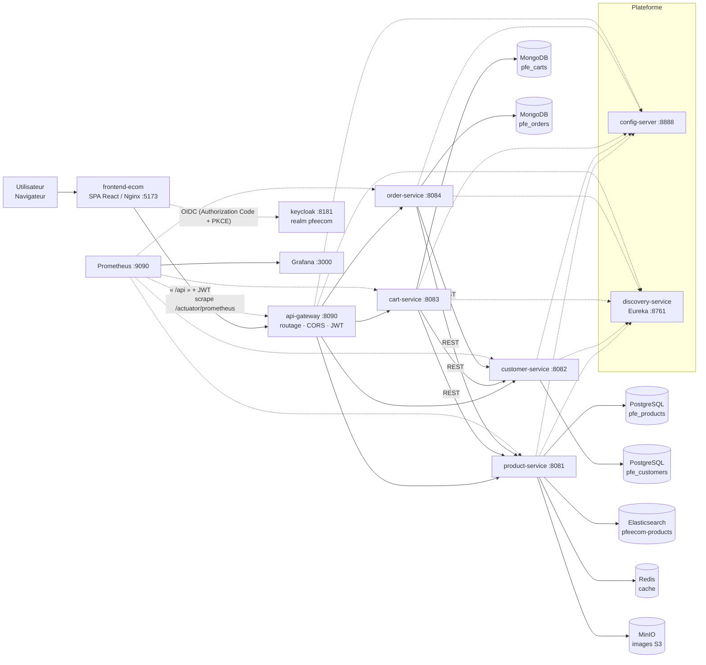

# Plateforme e-commerce en architecture microservices — PFE

> **Projet de Fin d'Études** — Conception et développement d'une plateforme e-commerce
> basée sur une architecture microservices.

| | |
|---|---|
| **Réalisé par** | Chouaib Raichy |
| **Encadrant** | Prof. Noreddine Abghour |
| **Établissement** | Faculté des Sciences Aïn Chock (FSAC) — Université Hassan II de Casablanca |
| **Année universitaire** | _[à préciser]_ |

Plateforme e-commerce composée de **quatre services métier** (catalogue, clients, paniers,
commandes) et de **trois briques plateforme** (configuration centralisée, découverte de
services, passerelle API), conteneurisée avec Docker Compose, sécurisée par **Keycloak (OIDC)**
et instrumentée pour l'**observabilité** (Prometheus + Grafana).

---

## Sommaire

1. [Contexte académique](#1-contexte-académique)
2. [Objectifs et périmètre](#2-objectifs-et-périmètre)
3. [Besoins fonctionnels et cas d'usage](#3-besoins-fonctionnels-et-cas-dusage)
4. [Architecture](#4-architecture)
5. [Inventaire des microservices](#5-inventaire-des-microservices)
6. [Choix technologiques](#6-choix-technologiques)
7. [Architecture des données](#7-architecture-des-données)
8. [Authentification et autorisation (Keycloak)](#8-authentification-et-autorisation-keycloak)
9. [Configuration, découverte et passerelle](#9-configuration-découverte-et-passerelle)
10. [Frontend et parcours utilisateur](#10-frontend-et-parcours-utilisateur)
11. [Démarrage avec Docker Compose](#11-démarrage-avec-docker-compose)
12. [Prérequis (versions vérifiées)](#12-prérequis-versions-vérifiées)
13. [Configuration et gestion sûre des identifiants](#13-configuration-et-gestion-sûre-des-identifiants)
14. [Construire et lancer le projet](#14-construire-et-lancer-le-projet)
15. [Tests](#15-tests)
16. [Validation du frontend](#16-validation-du-frontend)
17. [Documentation d'API (Swagger / OpenAPI)](#17-documentation-dapi-swagger--openapi)
18. [Observabilité](#18-observabilité)
19. [Kubernetes](#19-kubernetes)
20. [Initialisation et persistance des données](#20-initialisation-et-persistance-des-données)
21. [Dépannage](#21-dépannage)
22. [Résultats de tests actuels](#22-résultats-de-tests-actuels)
23. [Limites connues et perspectives](#23-limites-connues-et-perspectives)
24. [Structure du dépôt](#24-structure-du-dépôt)
25. [Attribution académique](#25-attribution-académique)

---

## 1. Contexte académique

Ce dépôt est le livrable technique du Projet de Fin d'Études de **Chouaib Raichy**, encadré par
**Prof. Noreddine Abghour** à la **FSAC (Université Hassan II de Casablanca)**. La
documentation d'exploitation, le rapport et le support de soutenance sont fournis dans le dépôt
(voir [Structure du dépôt](#24-structure-du-dépôt)).

## 2. Objectifs et périmètre

- **Objectif métier** : une boutique en ligne avec catalogue, comptes clients, panier et
  commandes en **paiement à la livraison**.
- **Objectif d'architecture** : découper le domaine en **microservices autonomes** et démontrer
  les briques d'une plateforme distribuée (configuration centralisée, découverte de services,
  passerelle, sécurité OIDC, observabilité).
- **Objectif qualité** : une base **testée** (135 tests automatisés), **reproductible**
  (une commande Docker Compose) et **documentée**.

Le périmètre est **strictement celui présent dans le code** : tout élément non implémenté est
listé dans [Limites connues](#23-limites-connues-et-perspectives).

## 3. Besoins fonctionnels et cas d'usage

- **Visiteur** : consulter le catalogue, rechercher, filtrer par catégorie ; constituer un panier
  **invité** conservé localement.
- **Client (`CUSTOMER`)** : se connecter (OIDC), fusionner son panier invité, commander en
  paiement à la livraison, suivre ses commandes, gérer son profil.
- **Administrateur (`ADMIN`)** : gérer le catalogue (produits, catégories, images), consulter les
  clients et toutes les commandes, relancer l'index de recherche.

| Cas d'usage | État |
|---|---|
| Catalogue, recherche, catégories | Implémenté |
| Panier invité → fusion puis panier serveur | Implémenté |
| Commande en **paiement à la livraison** (`CASH_ON_DELIVERY`) | Implémenté |
| Compte / profil / historique de commandes | Implémenté |
| Espace d'administration + contrôle d'accès par rôle | Implémenté |
| Paiement en ligne, décrément de stock, e-mail transactionnel | Non implémenté (voir limites) |

## 4. Architecture



Le **frontend** et les **quatre services métier** n'exposent au navigateur qu'un seul point
d'entrée : la **passerelle** (`api-gateway`). Les services métier restent sur le réseau Docker
privé (`pfe-net`).

## 5. Inventaire des microservices

| Service | Rôle | Persistance | Port (interne) |
|---|---|---|---|
| `config-server` | Configuration centralisée (Spring Cloud Config, `config-repo/`) | — | 8888 |
| `discovery-service` | Annuaire de services (Eureka) | — | 8761 |
| `api-gateway` | Point d'entrée unique, routage `lb://`, ressource serveur JWT, CORS, Swagger agrégée | — | 8080 (hôte 8090) |
| `product-service` | Catalogue : produits, catégories, images, recherche | PostgreSQL + Elasticsearch + Redis + MinIO | 8081 |
| `customer-service` | Clients : profils, provisionnement clé sur `sub` Keycloak | PostgreSQL | 8082 |
| `cart-service` | Paniers (lignes, quantités) — propriété contrôlée côté serveur | MongoDB | 8083 |
| `order-service` | Commandes — snapshot produit/client, statut, paiement | MongoDB | 8084 |

**Endpoints principaux** (via la passerelle, préfixés `/api`) :

| Méthode | Chemin | Accès |
|---|---|---|
| `GET` | `/api/products`, `/api/products/{id}`, `/api/products/search`, `/api/products/suggest`, `/api/products/{id}/image` | Public |
| `POST/PUT/DELETE` | `/api/products`, `/api/products/{id}`, `/api/products/{id}/image` | `ADMIN` |
| `POST` | `/api/products/reindex` | `ADMIN` |
| `GET` | `/api/categories`, `/api/categories/{id}` | Public |
| `POST/PUT/DELETE` | `/api/categories`, `/api/categories/{id}` | `ADMIN` |
| `POST` | `/api/customers/me` | Authentifié (provisionnement) |
| `GET` | `/api/customers` | `ADMIN` |
| `GET` | `/api/customers/{id}` | Propriétaire ou `ADMIN` |
| `POST/PUT/DELETE` | `/api/customers`, `/api/customers/{id}` | `ADMIN` |
| `GET/POST/DELETE` | `/api/carts/{customerId...}` | Propriétaire ou `ADMIN` |
| `GET/POST` | `/api/orders`, `/api/orders/{id}` | Propriétaire ou `ADMIN` |

## 6. Choix technologiques

| Besoin | Technologie | Justification |
|---|---|---|
| Services métier | **Java 21 + Spring Boot 3.3.10** | Écosystème mature pour les microservices et le Web réactif/servlet. |
| Brique plateforme | **Spring Cloud 2023.0.5** (Config, Eureka, Gateway) | Standard éprouvé pour config, découverte et routage. |
| Données relationnelles | **PostgreSQL 16** (JPA + Flyway) | Unicité, clés étrangères, contraintes `CHECK`, transactions. |
| Données documentaires | **MongoDB 7** | Agrégats (panier, commande) à lignes embarquées et snapshots. |
| Cache | **Redis 7.4** | Cache-aside des fiches produits/catégories, repli transparent. |
| Recherche | **Elasticsearch 8.13.4** | Recherche plein-texte + suggestions, avec repli PostgreSQL. |
| Stockage objet | **MinIO** (API S3) | Stockage des images produit (bucket privé, utilisateur à privilèges minimaux). |
| Identité | **Keycloak 26.1** (OIDC / OAuth2) | Rôles, attributs et jetons JWT sans réinventer l'authentification. |
| Frontend | **React 19 + Vite 7 + TypeScript 5.9** | SPA typée, `keycloak-js` pour l'Authorization Code + PKCE. |
| Conteneurisation | **Docker Compose** | Pile locale reproductible en une commande. |
| Observabilité | **Prometheus 2.54.1 + Grafana 11.2.0** | Métriques Micrometer/Actuator + tableaux de bord provisionnés. |
| Documentation d'API | **springdoc/OpenAPI 2.6.0** | Spécifications par service + Swagger UI agrégée au niveau de la passerelle. |

## 7. Architecture des données

**Persistance polyglotte** : chaque service possède **sa base** ; aucune jointure inter-services.

| Technologie | Propriétaire | Usage |
|---|---|---|
| **PostgreSQL** | `product-service` (`pfe_products`), `customer-service` (`pfe_customers`) | Données de référence : produits, catégories, clients. Schéma géré par **Flyway**. |
| **MongoDB** | `cart-service` (`pfe_carts`), `order-service` (`pfe_orders`) | Agrégats documentaires : paniers, commandes (lignes + snapshots). |
| **Redis** | `product-service` | Cache-aside des fiches produits/catégories (TTL 5 min, éviction à l'écriture). |
| **Elasticsearch** | `product-service` | Index `pfeecom-products`, alimenté depuis PostgreSQL via une **outbox durable** ; repli PostgreSQL si ES est indisponible (`degraded=true`). |
| **MinIO** | `product-service` | Images produit (bucket `pfeecom-product-images`, clé d'objet générée côté serveur). |

Détails : `docs/POLYGLOT_PERSISTENCE_DECISION.md`, `docs/ELASTICSEARCH-SETUP.md`,
`docs/MINIO-S3-SETUP.md`.

## 8. Authentification et autorisation (Keycloak)

- **Fournisseur OIDC** : Keycloak (realm `pfeecom`, URL publique `http://localhost:8181`).
- **Clients** : `pfeecom-frontend` (public, Authorization Code + **PKCE S256`), `pfeecom-swagger`
  (public), `pfeecom-api` (bearer-only), `pfeecom-provisioner` (compte de service, côté serveur).
- **Rôles** : `ADMIN` (gestion) et `CUSTOMER` (achat).
- **Jetons** : chaque service ressource vérifie signature, émetteur (`iss`) et audience.
- **Propriété** : l'identité client provient **toujours** du jeton (`customer_id`), jamais d'un
  identifiant fourni par le navigateur ; un accès à la ressource d'autrui renvoie **403**.

Matrice d'autorisation vérifiée : catalogue en **lecture publique** ; écritures réservées `ADMIN` ;
paniers/commandes réservés au **propriétaire** (ou `ADMIN`) ; accès non authentifié **401**.

## 9. Configuration, découverte et passerelle

- **Config Server** : distributeur de configuration (`config-repo/`, profil `native`, monté en
  lecture seule). Les valeurs sensibles passent par **variables d'environnement**.
- **Eureka** : chaque service s'enregistre ; la passerelle route via `lb://<service>` (résolution
  par nom logique, avec répartition de charge côté client).
- **Passerelle** : point d'entrée unique ; applique CORS, l'autorisation par rôle/propriété, et
  **agrège** la documentation OpenAPI des services. Son Actuator est exposé sur un **port de
  gestion interne** (`8081`) non publié sur l'hôte.

## 10. Frontend et parcours utilisateur

SPA servie par Nginx. Routes principales (`frontend-ecom/src/app/router.tsx`) :

| Route | Écran | Accès |
|---|---|---|
| `/`, `/catalog`, `/search`, `/products/:id` | Accueil, catalogue, recherche, fiche produit | Public |
| `/cart`, `/checkout` | Panier et récapitulatif de commande | Public / authentifié |
| `/orders`, `/orders/:id`, `/account`, `/account/profile`, `/account/orders` | Commandes et compte | Authentifié |
| `/admin_panel/...` | Console d'administration | `ADMIN` |

**Parcours** : navigation **invité** (catalogue + panier `localStorage`) ; à la connexion, le
panier invité est **fusionné** de façon **idempotente** avec le panier serveur. À la commande, le
frontend envoie `paymentMethod = CASH_ON_DELIVERY` ; la commande est créée avec un statut de
paiement `PENDING` (jamais marquée payée à la création). Les commandes sont visibles dans
`/orders`.

## 11. Démarrage avec Docker Compose

```powershell
# Depuis la racine du projet
docker compose -f docker-compose.ecom.yml up -d --build
docker compose -f docker-compose.ecom.yml ps      # 16 services healthy (+ minio-init : Exited 0)
```

Points d'accès :

| Composant | URL |
|---|---|
| Boutique (SPA) | http://localhost:5173 |
| API Gateway | http://localhost:8090 |
| Swagger UI agrégée | http://localhost:8090/swagger-ui.html |
| Keycloak (admin) | http://localhost:8181 |
| Eureka | http://localhost:8761 |
| Config Server | http://localhost:8888 |
| Prometheus | http://localhost:9090 |
| Grafana | http://localhost:3000 |

Comptes de **démonstration** (realm `pfeecom`) : `admin` (ADMIN), `yassine`, `sarah` (CUSTOMER).
Leurs **mots de passe sont définis par les variables d'environnement** `KEYCLOAK_DEMO_ADMIN_PASSWORD`,
`KEYCLOAK_DEMO_CUSTOMER_PASSWORD`, `KEYCLOAK_DEMO_CUSTOMER2_PASSWORD` (valeurs de repli non
sensibles dans `.env.example`) ; le fichier `keycloak/realm-pfeecom.json` ne contient **aucun mot de
passe en clair**. Voir [§13](#13-configuration-et-gestion-sûre-des-identifiants).

## 12. Prérequis (versions vérifiées)

| Outil | Version vérifiée |
|---|---|
| Java (JDK) | **21.0.9** |
| Maven | **3.9.16** |
| Node.js | **24.13.0** |
| npm | **11.8.0** |
| Docker Desktop | **29.2.1** (`docker compose`) |
| kubectl (K8s optionnel) | **1.34.1** |

> Le shell de référence est **Windows PowerShell 5.1**.

## 13. Configuration et gestion sûre des identifiants

- La configuration applicative vit dans `config-repo/` ; toute valeur sensible est
  externalisée via `${VAR:valeur_par_defaut}` (voir `config-repo/README.md`).
- Les identifiants présents dans `docker-compose.ecom.yml` sont des **valeurs de démonstration
  locale**, volontairement non secrètes, destinées à un poste de développement. Le royaume
  (`keycloak/realm-pfeecom.json`) ne contient **aucun mot de passe en clair** (placeholders
  `KEYCLOAK_DEMO_*`). Ces valeurs **doivent être remplacées** avant tout déploiement réel.
- **Aucun fichier `.env` réel n'est versionné.** Un modèle `.env.example` (valeurs fictives) est
  fourni ; copiez-le en `.env` si vous devez surcharger des valeurs.
- Ne commitez jamais d'identifiants, de jetons ou de clés privées.

## 14. Construire et lancer le projet

**Option Docker (recommandée)** : voir [§11](#11-démarrage-avec-docker-compose).

**Option locale par service** (profils `*-local` de `config-repo/`) :

```powershell
cd services/config-server ; mvn spring-boot:run      # puis, dans l'ordre :
cd ..\discovery-service   ; mvn spring-boot:run
cd ..\product-service     ; mvn spring-boot:run
# ... customer-service, cart-service, order-service, api-gateway
cd ..\..\frontend-ecom    ; npm install ; npm run dev
```

Chaque module se construit indépendamment (`mvn -B package`).

## 15. Tests

Les tests d'intégration utilisent des **bases isolées** (conteneurs `mongo-test:27018`,
`postgres-test:5433`, `redis-test:6380`, profil Compose `test`) :

```powershell
docker compose -f docker-compose.ecom.yml --profile test up -d mongo-test postgres-test redis-test

cd services/product-service  ; mvn -B test   # 52 tests
cd ..\customer-service       ; mvn -B test   # 17 tests
cd ..\cart-service           ; mvn -B test   # 19 tests
cd ..\order-service          ; mvn -B test   # 17 tests
cd ..\api-gateway            ; mvn -B test   # 30 tests
```

## 16. Validation du frontend

```powershell
cd frontend-ecom
npm run typecheck    # tsc --noEmit
npm run lint         # eslint
npm run test         # node --test (test runner intégré à Node ; aucun framework tiers)
npm run build        # tsc + vite build
```

## 17. Documentation d'API (Swagger / OpenAPI)

Chaque service publie sa spécification **OpenAPI 3** (springdoc). La passerelle **agrège** les
quatre specs dans une **Swagger UI** unique :

- **Swagger UI** : http://localhost:8090/swagger-ui.html
- Spécifications par service : `/api-docs/<service>` (ex. `/api-docs/product-service`)

L'authentification « Try it out » utilise le schéma `bearerAuth` ou le client public
`pfeecom-swagger` (Authorization Code + **PKCE**). Détails : `docs/SWAGGER-OPENAPI.md`.

## 18. Observabilité

- **Prometheus** scrape **7 cibles** (job `pfe-ecom`) : config-server, discovery, les 4 services
  métier et l'Actuator interne de la passerelle, sur `/actuator/prometheus`.
- **Grafana** fournit le tableau de bord provisionné `pfe-ecom-overview` (11 panneaux), source de
  données Prometheus configurée au démarrage.
- L'Actuator de la passerelle n'est **pas** exposé sur le port public.

Accès : Prometheus http://localhost:9090 · Grafana http://localhost:3000 (`admin`/`admin`).

## 19. Kubernetes

Le dépôt contient un **déploiement Kubernetes local** (Kustomize) pour Docker Desktop :
`k8s/kustomization.yaml` (38 ressources : 1 namespace, 2 ConfigMap, 14 Service, 6 PVC,
14 Deployment, 1 Job), scripts `k8s/scripts/*.ps1`, et un Secret **généré, non versionné**.

> **Important — le cluster n'a PAS été déployé.** Les manifestes ont été **validés
> statiquement** (`kubectl kustomize k8s` → 38 documents, `--dry-run=client`). Le contrôle
> `--dry-run=server` complet est bloqué (le namespace éphémère n'est pas persisté). Aucune
> affirmation de déploiement Kubernetes n'est faite. L'observabilité n'est pas incluse dans les
> manifestes ; `monitoring/` reste la référence Compose.

Procédure : `k8s/scripts/deploy.ps1` (non exécutée) ; accès via `k8s/scripts/port-forward.ps1`
(frontend 5173, gateway 8090, keycloak 8181).

## 20. Initialisation et persistance des données

- **PostgreSQL** : schéma géré par **Flyway** au démarrage de chaque service
  (`product-service` : V1 schéma, V2 seed, V3 outbox recherche, V4 clé image ;
  `customer-service` : V1 schéma, V2 seed, V3 provisionnement). `ddl-auto=validate`.
- **MongoDB** : bases créées à la volée par les services ; compteurs via une collection
  `sequences`.
- **Volumes nommés** (`postgres-data`, `mongo-data`, `keycloak-data`, `prometheus-data`,
  `grafana-data`, `redis-data`, `elasticsearch-data`, `minio-data`) : les données **survivent** à
  un `docker compose stop`/`up` (sans `-v`).
- **Ne jamais** exécuter `docker compose down -v` : cela détruirait les données.

## 21. Dépannage

| Symptôme | Piste |
|---|---|
| Un service reste `unhealthy` | `docker compose -f docker-compose.ecom.yml logs <service>` ; vérifier Config Server et Eureka. |
| Cible Prometheus `DOWN` | Vérifier que le service expose `/actuator/prometheus` et que le job `pfe-ecom` cible le bon port. |
| `401` inattendu | Le jeton doit venir du realm **`pfeecom`** (un jeton du realm `master` est refusé). |
| Carte produit vide | Vérifier Elasticsearch ; le service retombe sinon en repli PostgreSQL (`degraded=true`). |
| `customer_id` absent du jeton | Le provisionnement `POST /api/customers/me` doit être exécuté puis le jeton rafraîchi. |

Dépannage détaillé : `docs/RUNBOOK_ECOM.md` (§10, §12).

## 22. Résultats de tests actuels

> Mesurés le **13/10/2026** sur la pile en fonctionnement. Les rapports Surefire sont datés du
> 13/10/2026 (09:21–09:25).

| Vérification | Résultat | Statut |
|---|---|---|
| Tests backend (5 modules) | **135/135** — product 52, customer 17, cart 19, order 17, gateway 30 (0 échec/erreur/ignoré) | PASS |
| Frontend `typecheck` / `lint` / `build` | OK (lint : 0 erreur, 5 avertissements préexistants) ; `npm test` 3/3 | PASS |
| Conteneurs | **16 `healthy`** (+ `minio-init` : `Exited 0`) | PASS |
| Eureka | 5 applications enregistrées | PASS |
| Prometheus | **7/7** cibles `up` | PASS |
| Frontière de sécurité (via gateway) | `/api/customers` sans jeton → **401**, catalogue → **200** | PASS |
| Smoke test navigateur **non destructif** (Chrome headless/CDP) | rendu SPA, proxy `/api`, recherche ES, redirection OIDC | PASS |
| Parcours navigateur **authentifié** panier → commande | non exécuté (écriture de données métier) | **NOT TESTED** |
| Déploiement Kubernetes | manifestes validés statiquement | **NOT TESTED** (déploiement) |

Les résultats plus anciens (52, 103, 131 tests selon les documents) sont **historiques** et
préservés dans `docs/` ; ils ne décrivent pas l'état courant. Voir `docs/FINAL_RELEASE_AUDIT.md`.

## 23. Limites connues et perspectives

**Limites actuelles (assumées)**
- Appels **inter-services non authentifiés** (repose sur l'isolation réseau Docker).
- **Pas de transaction distribuée** ; cohérence par snapshots.
- **Stock non décrémenté** à la commande.
- Pas de **TLS** ni d'**alerting** Prometheus dans la pile de démonstration.
- Parcours navigateur authentifié panier→commande **non automatisé** (voir §22).
- Kubernetes **non déployé**.

**Perspectives**
- Sécuriser les appels inter-services (client-credentials ou mTLS).
- Règles d'alerte Prometheus + Alertmanager ; TLS de bout en bout.
- Décrément/réservation de stock (Saga), versioning d'API, tests de contrat (WireMock).
- Réactivation d'un pipeline **CI** et industrialisation GitOps.

## 24. Structure du dépôt

```
PFE/
├── services/                 # 7 modules Spring Boot (Maven)
│   ├── config-server/        # configuration centralisée
│   ├── discovery-service/    # Eureka
│   ├── api-gateway/          # passerelle API
│   ├── product-service/      # catalogue (PostgreSQL + ES + Redis + MinIO)
│   ├── customer-service/     # clients (PostgreSQL)
│   ├── cart-service/         # paniers (MongoDB)
│   └── order-service/        # commandes (MongoDB)
├── frontend-ecom/            # SPA React + Vite (Nginx)
├── config-repo/              # configuration externalisée (Spring Cloud Config)
├── keycloak/                 # realm pfeecom + thème + scripts
├── docker/                   # scripts d'init PostgreSQL / MinIO
├── monitoring/               # Prometheus + Grafana
├── k8s/                      # manifestes Kubernetes (non déployés)
├── docs/                     # documentation (runbook, audits, setup)
├── rapport/                  # rapport PFE
├── soutenance/               # support de soutenance + notes
├── docker-compose.ecom.yml   # pile complète
└── README.md
```

## 25. Attribution académique

- **Étudiant** : Chouaib Raichy
- **Encadrant** : Prof. Noreddine Abghour
- **Établissement** : FSAC — Université Hassan II de Casablanca
- **Sujet** : Conception et développement d'une plateforme e-commerce basée sur une architecture
  microservices

---

<sub>Documentation d'exploitation : `docs/RUNBOOK_ECOM.md` · Guide de soutenance :
`GUIDE_SOUTENANCE.md` · Audit de release : `docs/FINAL_RELEASE_AUDIT.md`.</sub>
